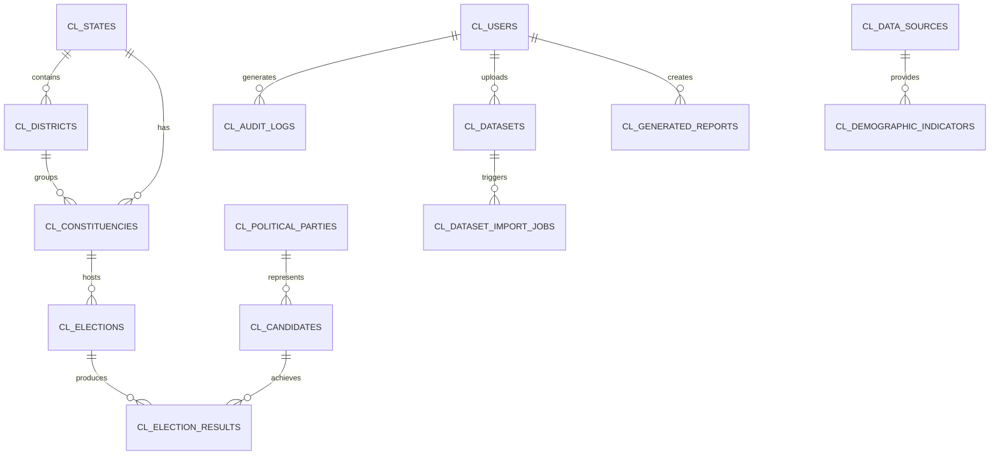

# CivicLens Database Schema Documentation

CivicLens uses a normalized PostgreSQL relational database schema.

## Primary Tables

- **`cl_users`**: Extends `AbstractUser` with `role`, `department`, `phone`, timestamps.
- **`cl_states`**: `state_code` (unique), `name`, `capital`, `latitude`, `longitude`.
- **`cl_districts`**: `district_code` (unique), `state_id`, `name`, `headquarters`.
- **`cl_constituencies`**: `constituency_code` (unique), `name`, `state_id`, `district_id`, `constituency_type`, `latitude`, `longitude`, `geojson_data`.
- **`cl_political_parties`**: `abbreviation` (unique), `name`, `color_hex`.
- **`cl_candidates`**: `name`, `party_id`, `candidate_reference`.
- **`cl_elections`**: `election_year`, `election_type`, `constituency_id`, `total_electors`, `total_votes_polled`, `turnout_percentage`.
- **`cl_election_results`**: `election_id`, `candidate_id`, `votes_received`, `vote_share`, `position`.
- **`cl_demographic_indicators`**: `name`, `category`, `region_type`, `region_identifier`, `value`, `unit`, `reference_year`.
- **`cl_news_articles`**: `title`, `category`, `sentiment_label`, `sentiment_score`, `geographic_reference`, `article_url` (unique).
- **`cl_datasets`**: `dataset_name`, `dataset_type`, `file`, `processing_status`, `row_count`.
- **`cl_dataset_import_jobs`**: `dataset_id`, `status`, `total_records`, `successful_records`, `failed_records`, `error_log`.
- **`cl_generated_reports`**: `title`, `report_type`, `file_format`, `file_path`, `status`.
- **`cl_audit_logs`**: `user_id`, `action`, `resource_type`, `resource_id`, `timestamp`.

